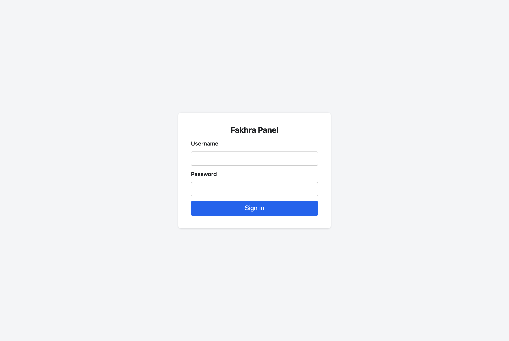
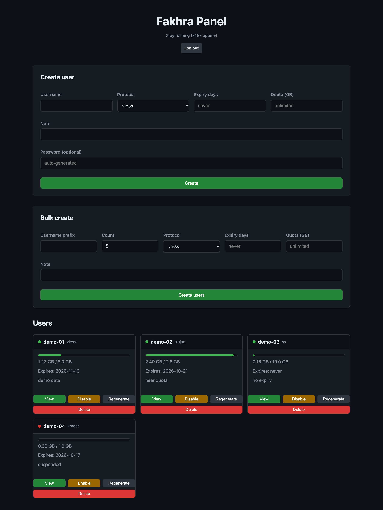
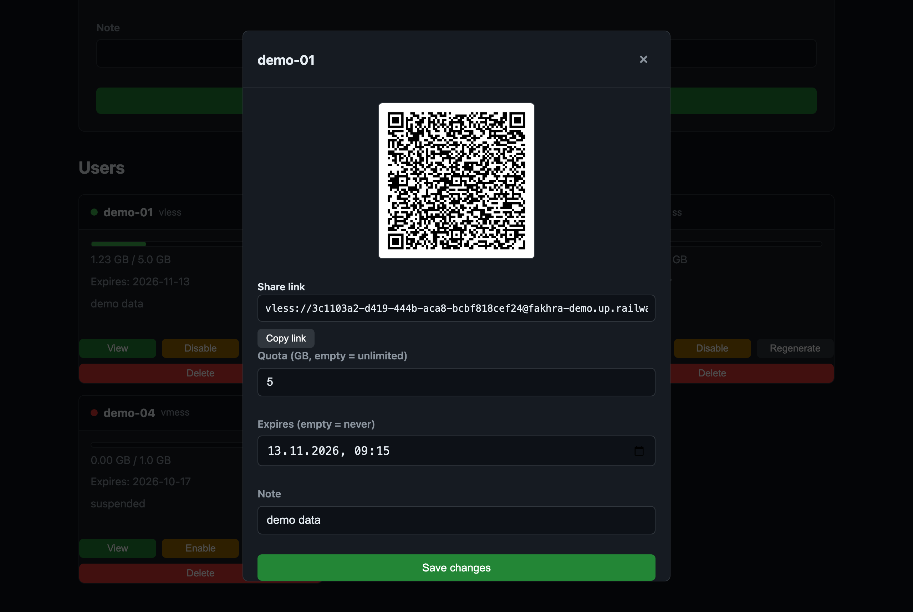
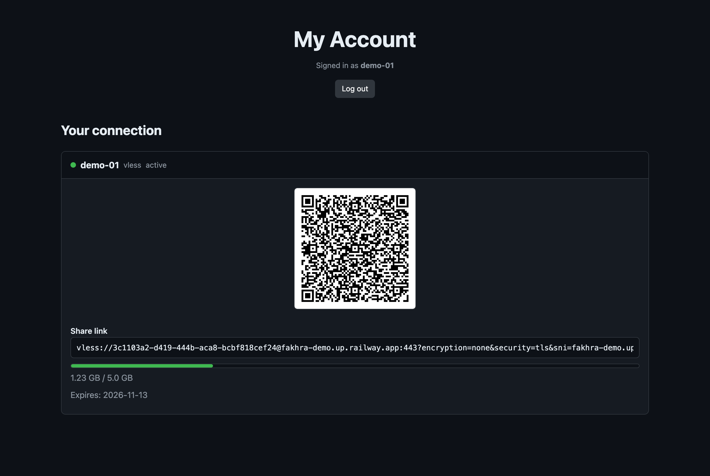

# Fakhra Panel

A VPN panel that actually works: create **Xray (V2Ray) VPN accounts** for the
four mainstream protocols — **VLESS, VMess, Trojan, Shadowsocks** — share
them as standard `vless://` `vmess://` `trojan://` `ss://` links + QR codes
that any major client (v2rayNG, V2Box, Clash/mihomo, Happ, …) understands,
and manage **expiry dates, traffic quotas, live stats, bulk creation, and a
self-service user page** — deployed as a single container with a
one-command installer on your own VPS.

- **Admin dashboard** at `/` (login with `ADMIN_USERNAME` / `ADMIN_PASSWORD`).
- **Self-service page** at `/account` — each user sees only their own link,
  usage, and expiry.
- **Dynamic inbound engine (v0.2)** — the panel owns Xray's inbounds:
  create/replace/remove them over the API (REALITY, WS, gRPC, xhttp, plain
  TCP), every save gated by the real `xray run -test` **and** a port bind
  probe before it goes live, with automatic rollback if the swap fails.
  Users are auto-assigned to an inbound; links are built from the inbound's
  own port and settings.
- **Subscription URL** — every user gets `/sub/<token>`: a rate-limited,
  `no-store`, base64 link list importable by any client that speaks
  subscriptions.
- **Enforcement jobs** run every 30 s: expired → disabled (reason `expired`),
  over quota → disabled (reason `quota`), traffic counters polled from Xray's
  StatsService over gRPC.
- **Fail-safe config lifecycle**: a candidate Xray config is validated with the
  real `xray run -test` before it replaces the live one — a bad change can
  never take the VPN down.

## Screenshots

Captured against a local instance with obviously fake demo users. They
predate the v0.2 inbound engine — the UI overhaul (inbound editor included)
is sub-project B of the roadmap and will re-capture them.

**Sign in** — the admin login at `/`:



**Admin dashboard** — single/bulk create on top, every user below with a live
usage bar, expiry, and per-user actions (demo-04 is suspended):



**Share link & QR** — *View* on any user opens the connection details, ready
to copy or scan:



**Self-service account page** — users sign in at `/account` and see only
their own link, usage, and expiry:



## Architecture (single container, three listeners)

```
Internet
 ├── :443        Xray — VLESS + REALITY inbound (seed; does its own TLS)
 ├── :10002-4…   Xray — other inbounds: seeds + anything you create, one port each
 ├── :8080       Caddy — panel (HTTPS via Let's Encrypt when AUTO_TLS)
 └── :80         Caddy — ACME HTTP-01 + HTTP→HTTPS redirect → :8080
```

One container running three processes:

- **Xray** owns every VPN port directly — nothing proxies in front of it.
  The panel writes its config (one inbound per panel-managed row), owns its
  lifecycle (validated apply, restart-with-backoff), and reads traffic stats
  over gRPC. The stats API inbound stays loopback-only.
- **Caddy** fronts only the panel on `:8080` (auto-TLS in VPS mode, plain
  behind a PaaS edge) — no VPN traffic ever touches it.
- The **entrypoint** bootstraps (DB + Caddyfile), starts Caddy then the
  panel, and tears the container down if either child dies (a half-alive
  container never looks healthy).
- Share links are per-inbound: address = `PUBLIC_HOST`, port = that
  inbound's own port, transport/security from its settings.

## Quickstart — your own VPS (recommended)

```bash
git clone https://github.com/vedromdev/FakhraPanel-Railway
cd FakhraPanel-Railway
sudo bash install.sh
```

Ubuntu/Debian with a domain pointed at the server. The installer handles
Docker, admin credentials, the firewall (80/443/8080 + seed VPN ports), BBR
kernel tuning, and **Let's Encrypt HTTPS** (Caddy owns :80 and serves the
panel on :8080 via `AUTO_TLS=true`), then prints your login URL. Full
walkthrough + first-deploy checklist: [DEPLOY.md](DEPLOY.md) (Option A).

## Quickstart — Docker locally (full fidelity)

```bash
git clone https://github.com/vedromdev/FakhraPanel-Railway
cd FakhraPanel-Railway

cp .env.example .env      # then edit: ADMIN_USERNAME, ADMIN_PASSWORD, PUBLIC_HOST
docker compose up panel
```

Dashboard: <http://localhost:8080>. This boots the exact production stack
(Caddy + panel + Xray) with `./data` mounted at `/data`. Only `8080` is
published — Xray's inbound ports stay inside the container; to test a
client on your LAN, add `ports:` mappings for the inbound you're testing
(e.g. `"443:443"`) before `up`.

## Local development (venv)

The steps that are **not** obvious on a fresh clone (skip them and tests skip
or fail with confusing reasons):

```bash
# 1. virtualenv + dependencies (requirements-dev.txt = pytest, httpx2, grpcio-tools)
python3 -m venv .venv && source .venv/bin/activate
pip install -r requirements.txt -r requirements-dev.txt

# 2. fetch the pinned Xray-core release into .bin/xray
#    (needed by the config tests that validate with the real `xray run -test`)
bash scripts/fetch_xray.sh

# 3. generate the gRPC stubs into panel/xray/pb/
#    (without them, the stats/integration tests SKIP with an actionable reason)
bash scripts/gen_protos.sh

# 4. configure + run
cp .env.example .env      # set ADMIN_USERNAME, ADMIN_PASSWORD, PUBLIC_HOST
python3 -m panel.main     # dashboard on http://localhost:8080 (XRAY_BIN=xray on PATH,
                          # or XRAY_BIN=.bin/xray to use the fetched binary)
```

Local uvicorn mode runs the panel (and its Xray child) directly — Xray
binds its inbound ports on your machine (pick an unprivileged port for
local connect tests), and there's no Caddy in front; the Docker stack
above adds the `:8080` HTTPS edge.

## Tests

```bash
# local (fast): unit + integration-minus-Docker — integration tests skip
# unless IN_DOCKER=1; stats tests skip if the stubs from gen_protos.sh are absent
python3 -m pytest tests/ -v
```

> **Note:** run the suite **before** creating your `.env` (or move it aside).
> pydantic-settings reads a local `.env` if present, and ambient values
> (e.g. `AUTO_TLS=true`) would leak into the hermetic tests — on a fresh
> clone (no `.env`) the suite is green.

```bash
# full gate (real container: Caddy + panel + real xray — direct-port WS 101,
# REALITY e2e client connect, /ray- 404, entrypoint supervision, gRPC stats)
docker compose build test && docker compose run --rm test
```

## Deploy on Railway in 5 steps

> **Have a VPS? Use the installer above instead** — that's the primary path
> now. Railway banned this project's account under their AUP; this section
> stays as a walkthrough for Railway-style PaaS hosts that accept it. Note
> the v0.2 casualty: **single-port hosts carry the panel only** — Xray owns
> its VPN ports directly now, and a one-port host can't expose them, so
> generated links won't carry traffic there (see [DEPLOY.md](DEPLOY.md)
> Option B).

A condensed follow-along for the free plan — one service, one container, one
port. Like the rest of the Railway docs in this repo this is **a walkthrough,
not a logged deployment**: the test suites and local-container checks are what
has actually been run here. [DEPLOY.md](DEPLOY.md) has the full version,
including the post-deploy E2E checklist.

### 1. Create the service

[railway.app](https://railway.app) → **New Project** → **Deploy from GitHub
repo** → select
[`vedromdev/FakhraPanel-Railway`](https://github.com/vedromdev/FakhraPanel-Railway).
Railway detects the `Dockerfile` and builds the image — Xray, Caddy, and the
panel are baked in, no build arguments needed.

### 2. Set the environment variables

Service → **Variables** → add:

| Variable | Value |
|---|---|
| `ADMIN_USERNAME` | your admin login name |
| `ADMIN_PASSWORD` | long random value: `python3 -c "import secrets; print(secrets.token_urlsafe(32))"` — defaults to `admin` if unset (boot warning), so set it before the service is public |
| `PUBLIC_HOST` | `<your-app>.railway.app` — you'll fill this in during step 4 |
| `SECRET_KEY` | optional — session-signing key; leave blank to auto-generate and persist it in the DB |

Leave everything else alone: Railway injects `PORT`, and the defaults
(`DATA_DIR=/data`, `XRAY_BIN=xray`, `COOKIE_SECURE=true`) are correct for the
HTTPS edge. A blank `PUBLIC_HOST` logs an ERROR at boot and share links/QR
generation fails until it's set.

### 3. Attach the volume

Service → **Settings → Volumes → Add Volume**, mount path exactly:

```
/data
```

The free plan includes a 0.5 GB volume — plenty for the SQLite DB and Xray
config. **Without it, every redeploy starts from an empty database.**

### 4. Generate the public hostname

Service → **Settings → Networking → Generate Domain** → copy the free
`*.railway.app` hostname into `PUBLIC_HOST` (step 2) and restart the service.
`PUBLIC_HOST` becomes the address in generated links — but on single-port
hosts the inbound ports aren't exposed, so those links won't carry traffic
(panel-only caveat above).

### 5. Healthcheck, deploy, verify

In the service **Settings** set healthcheck path `/api/health`, healthcheck
timeout `30`, and restart policy **on failure** (the same three values sit in
[`railway.toml`](railway.toml), but Railway is deprecating Config as Code —
prefer the dashboard settings). Then trigger a deployment and check:

```bash
curl -s https://<your-app>.railway.app/api/health
# {"status":"ok","xray":{"running":true,"last_error":"","uptime_s":…}}
```

Open `https://<your-app>.railway.app/` and log in with your
`ADMIN_USERNAME` / `ADMIN_PASSWORD` — you should see the dashboard from the
screenshots above.

Full walkthrough, env-var reference, and the manual E2E checklist:
**[DEPLOY.md](DEPLOY.md)** · every environment variable:
[`.env.example`](.env.example).

Repository: <https://github.com/vedromdev/FakhraPanel-Railway>
